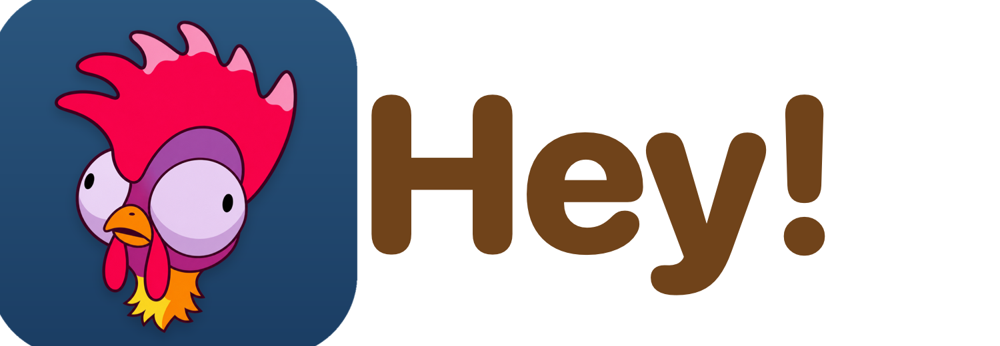
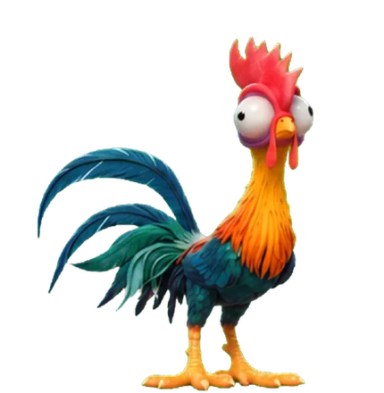

<p align="center"></p>

<h3 align="center">A little friend for your Mac desktop</h3>

<p align="center">
  
  
  
</p>

<p align="center">
  <a href="https://github.com/giganto-th/hey/releases/latest"></a>
  <a href="https://giganto-th.github.io/hey/en/"></a>
  <a href="https://www.youtube.com/watch?v=JBi-y-_I9jk"></a>
</p>

<p align="center"><a href="README.md">ภาษาไทย</a> · English</p>

---

**Hey!** is a 2D pet for your macOS screen. **Hei Hei** the rooster wanders around the desktop, notices what you are doing, nudges you to rest your eyes when you type for long, cheers when a focus round ends, and brings small tools that really help. Everything runs on your Mac and needs no account.

> Requires **macOS 26 (Tahoe)** or later (the look uses Liquid Glass).

## Features

| | |
|---|---|
| **Knows you, never nags** | Pecks along with your typing, reminds you to rest, gets sleepy when the Mac is idle, pants when it is hot, reacts to the battery and charger |
| **Hey Hub** | A Liquid Glass hub: status, quests, shop, achievements, a mini-game, adjustable window opacity |
| **Pomodoro focus** | 25 minutes of focus, 5 of rest; coins and XP for your pet |
| **Helpful tools** | Clipboard history · read text from the screen (Thai/English) · screenshots and screen recording · sticky notes · reminders in Thai or English · calendar heads-up |
| **AI credits** | The plan quotas of Claude, Codex (ChatGPT) and Antigravity, several accounts each, with the provider's real logo; the pet warns you at 80% and 95%; a percentage next to the menu-bar icon when one runs low |
| **File shelf and music** | Drop files, text or links onto the pet to keep them; play YouTube or audio files and the pet sways along |
| **Three friends** | Hei Hei the rooster, Shams the fluffy chick and Shi Shi the bob-haircut chick, with poses and animations for every growth stage |
| **Play** | Drop food anywhere and the pet walks over to eat it; blow bubbles for it to chase and peck |
| **Two languages** | Thai and English, chosen in Hub › Settings › Language |

## Install

**Fastest, with no warning:** open Terminal and run

```bash
curl -fsSL https://raw.githubusercontent.com/giganto-th/hey/main/scripts/install.sh | bash
```

The script downloads the latest release with curl (a file downloaded with curl carries no quarantine flag, so macOS does not ask), puts it in Applications and opens it.

**Or download it yourself:** get `Hey-1.2.0.dmg` from [Releases](https://github.com/giganto-th/hey/releases/latest) and drag Hey onto Applications. The app is signed with a Developer ID and notarized by Apple, so it opens with a double-click and no warning (versions up to 1.1.0 were not notarized).

Build it yourself with `bash scripts/make-app.sh` (gives `build/Hey.app`) and `bash scripts/make-dmg.sh` (gives the .dmg).

## Using it

- **Click the egg** to warm it; once it hatches, feed it.
- **Right-click the pet** for the round menu (buttons and your own folders, edited in Hub › Settings). **Click the Hey! icon in the menu bar** for the summary menu: the pet card, AI credits and commands. Option-click the icon for the round menu.
- **Feed:** round menu › Food, pick a food and click anywhere on the screen; the pet walks over to eat it.
- **Shortcuts** (anywhere): ⌃⌥R quick reminder · ⌃⌥N note · ⌃⌥P Pomodoro · ⌃⌥H Hub · ⌃⌥S screenshot · ⌃⌥V record · ⌃⌥M play/pause · ⌃⌥] / ⌃⌥[ next/previous song.
- **Files:** drag anything onto the pet and drop it on a slot: *Vault* (kept) or *Park for later* (a temporary shelf you drag out of).
- **Links:** `hey://focus/start`, `hey://note?text=…`, `hey://clip?n=0`, `hey://hub?page=…`, `hey://bubbles` work from Shortcuts' "Open URLs".

### AI credits troubleshooting

- **Claude says the login expired:** sign in again in Claude Code using the same account and config folder, then refresh AI credits. Hey reads the existing login; it does not renew or replace Claude Code credentials.
- **Codex:** quota is the last reading recorded in local sessions, not a live server check. Hey reads `.jsonl` sessions and `.jsonl.zst` sessions when `zstd` is installed at `/opt/homebrew/bin/zstd`, `/usr/local/bin/zstd`, or `/usr/bin/zstd` (`brew install zstd` on Homebrew). Sessions with null quota windows are skipped in favor of an older reading; check the displayed reading time. If no session has quota, Hey cannot infer it from token counts.

## For developers

```bash
swift build && .build/debug/Hey      # run from the project folder
swift test                            # pure logic in HeyDomain
python3 scripts/l10n_keys.py          # every visible string needs an English translation
```

- `Sources/HeyDomain`: pure logic (pet, behavior, quests, quotas…), tested with Swift Testing.
- `Sources/Hey`: the AppKit, SpriteKit and SwiftUI app. Visible text goes through `tr("Thai text")`; English lives in `Resources/Localization/en.json`.
- Docs: [DESIGN](docs/DESIGN.md) · [ROADMAP](docs/ROADMAP.md) · [sprite pipeline](docs/SPRITE_PIPELINE.md) · [signing](docs/SIGNING.md).
