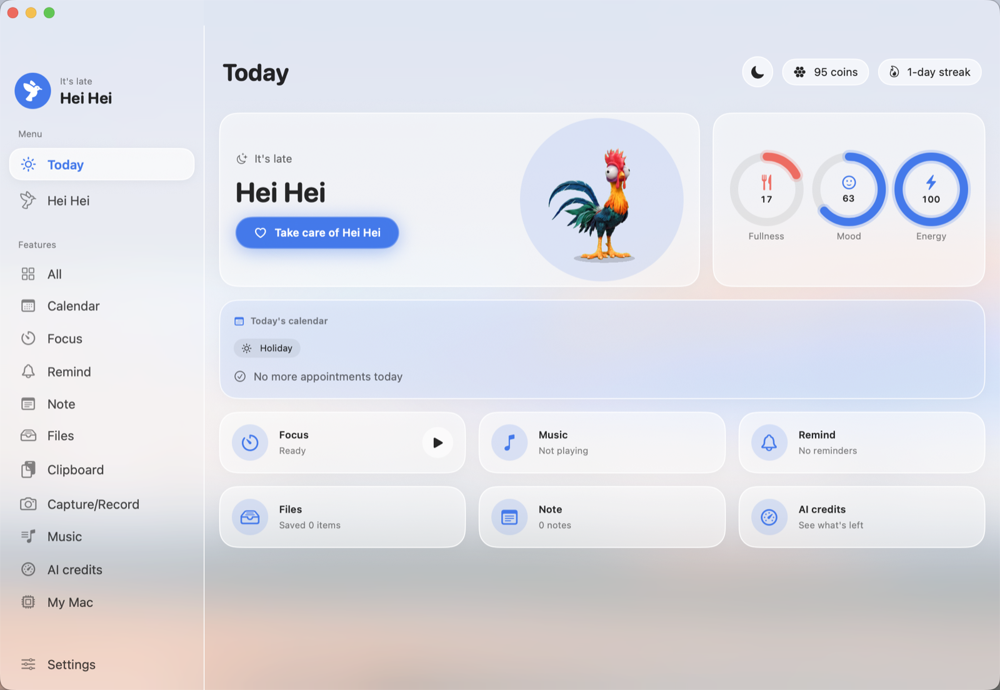
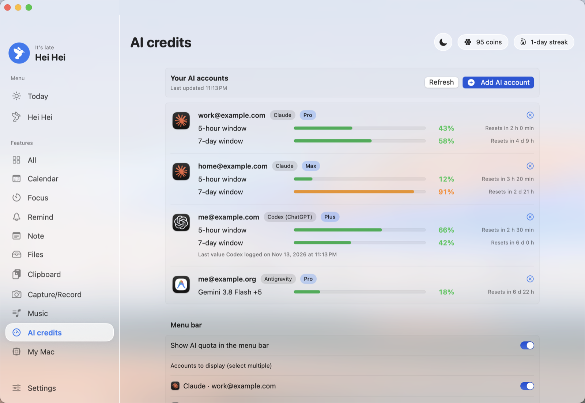
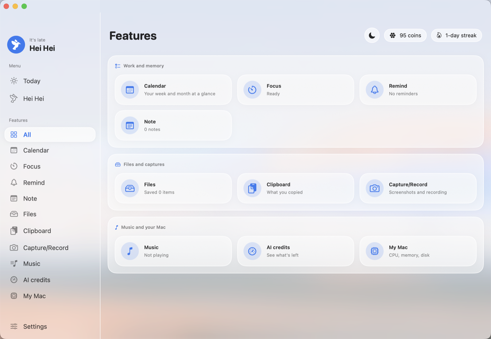
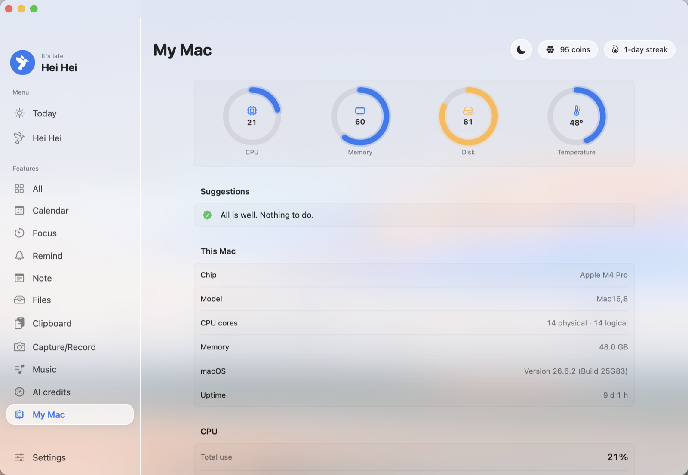
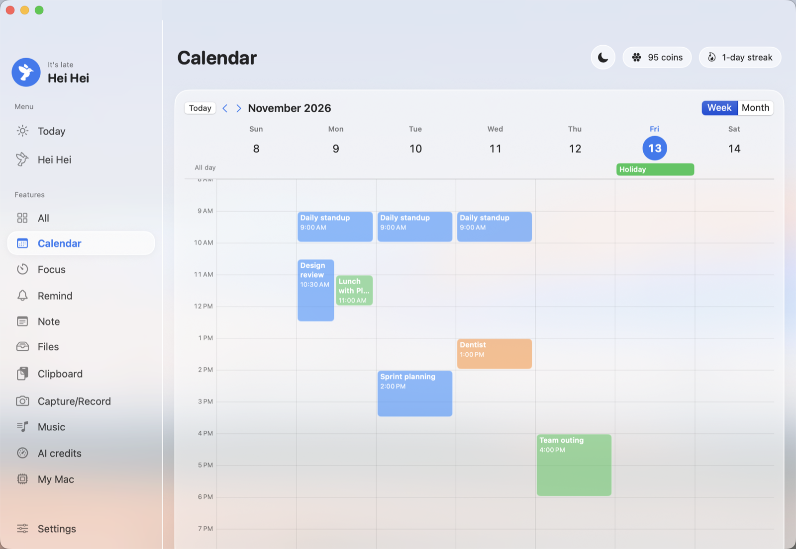
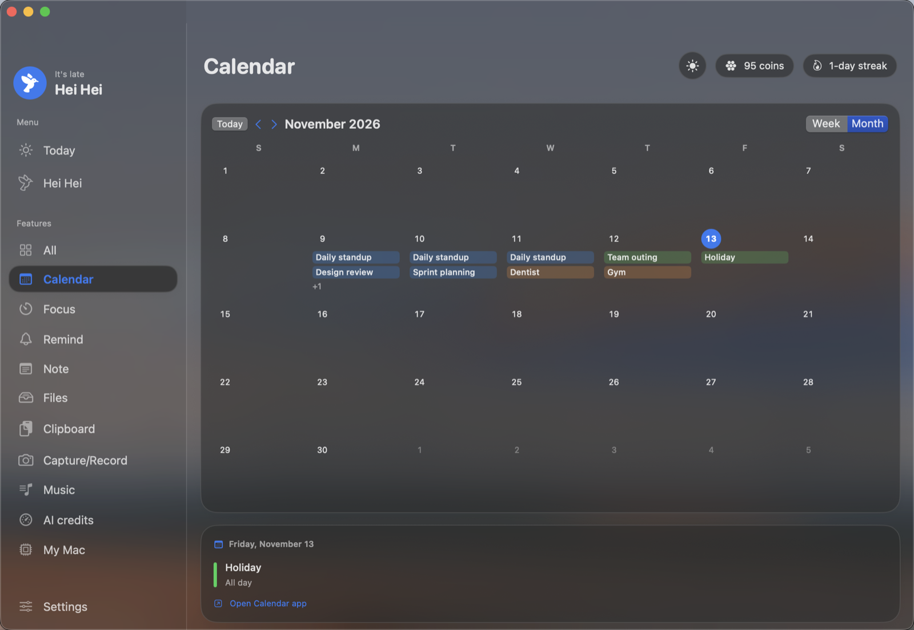
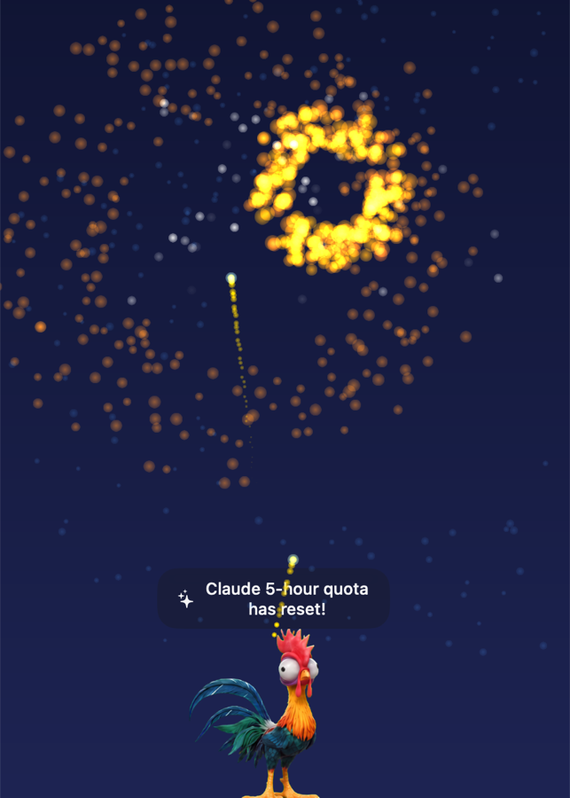

<p align="center"></p>

# Hey!

> A little desktop pet for your Mac, with the everyday tools you actually use.

[](https://github.com/giganto-th/hey/releases/latest)
[](https://github.com/giganto-th/hey/releases/latest)
[](Package.swift)
[](https://github.com/giganto-th/hey/releases/latest)
[](docs/SIGNING.md)
[](LICENSE)
[](https://giganto-th.github.io/hey/en/)

English · [ภาษาไทย](README.th.md)

<p align="center">
  
  
  
</p>

**Hey!** puts **Hei Hei**, a small 2D rooster, on your macOS desktop. It walks around, pecks along while you type, dances to your music, gets sleepy when the Mac is idle and tells you when something needs your attention. Behind it sits the **Hey Hub**: focus timer, reminders, notes, clipboard history, a file vault, screen capture, a calendar, your AI plan quotas and a look at your Mac's health. Everything runs locally and needs no account.

<p align="center">
  
  
</p>

## Why

- **A companion, not a nag.** The pet reacts to what you do (typing, music, battery, heat, idle time) and speaks up only when it matters.
- **One place for small tools.** The things you reach for twenty times a day live in one glass window, a right-click or a shortcut away.
- **Know your AI limits.** Claude, Codex (ChatGPT) and Antigravity quotas for several accounts, with reset times; the pet warns you at 80% and 95% and sets off fireworks when a window resets.
- **Light on your Mac.** Nothing animates while you are not looking, measurements run only while their page is open, and the pet drops its frame rate on battery.
- **Private by default.** No sign-up, no analytics, no server. Data stays in `~/Library/Application Support/Hey`.

## Install

### Requirements

- macOS 15 (Sequoia) or later. macOS 26 gets the full Liquid Glass look; macOS 15 uses translucent materials.
- Apple Silicon or Intel (one universal build).

### One-line install

```bash
curl -fsSL https://raw.githubusercontent.com/giganto-th/hey/main/scripts/install.sh | bash
```

Downloads the latest release into `/Applications` and opens it.

### GitHub Releases

Download the latest `.dmg` from [Releases](https://github.com/giganto-th/hey/releases/latest) and drag **Hey** to **Applications**. Releases are signed with a Developer ID and notarized by Apple, so they open without a warning.

### Updates

Hey! checks GitHub once a day. When a new version is out, press **Update now** in the Hub: it downloads the release, verifies the hash, the signing team and the notarization, swaps the app and reopens it. Nothing installs unless you press the button.

### First run

1. Click the egg to warm it until it hatches, then pick a name.
2. Right-click the pet for its round menu, or click the menu bar icon for the summary menu.
3. Open the Hub (`⌃⌥H`) and turn on what you want: AI credits, calendar, music, reactions.

## Features

### The pet

- Three characters: **Hei Hei** the rooster, **Shams** the fluffy chick and **Shi Shi** the bob-haired chick.
- Grows from egg to hatchling, child, teen and adult; teens and adults can stand on the top edge of other windows.
- Drop food anywhere on the screen and it walks over to eat; blow bubbles for it to chase and peck.
- Reacts to typing, music, low battery, the charger, heat, idle time and waking from sleep. Each reaction can be turned off.
- Quests, a shop, 21 achievements and a mini-game. A neglected pet can die after 12 hours at zero (with warnings first; switch it off in the pet's Overview). Your collection stays.

### Hey Hub

A Finder-style glass window with a sidebar: **Today**, the pet pages, **Features** and **Settings**. Background blur and opacity are adjustable, and a sun/moon button switches between light and dark (or follow the system).

<p align="center">
  
  
</p>
<p align="center">
  
  
</p>

| Feature | What it does |
|---|---|
| **Calendar** | A week time grid and a month grid in each calendar's colour, today's card with a countdown and a one-click Join for Zoom, Meet, Teams and Webex links, and a heads-up before meetings. Read-only. |
| **Focus** | Pomodoro: 25 minutes of focus, 5 of rest, coins and XP for the pet. |
| **Reminders** | Type it the way you say it: `meeting in 20 min`, `tomorrow 9am send report`, Thai works too. |
| **Notes** | Sticky notes that float on the screen. |
| **Vault and shelf** | Drag files, text or links onto the pet: keep them in the vault, or park them on a temporary shelf to drag out later. |
| **Clipboard** | History of what you copied, ready to paste again. |
| **Capture** | Screenshots, area capture, screen recording, camera, and text recognition from the screen (Thai and English). |
| **Music** | Play YouTube links and audio files; the pet dances along. Copy a YouTube link and Hey! offers to add it. |
| **AI credits** | Plan quotas per account with reset times, an optional percentage in the menu bar, alerts at 80% and 95%, fireworks at reset. |
| **My Mac** | CPU, memory, disk and temperatures with plain-language advice, a week of history, battery health, login agents and space you can free. |

### AI credits



When a 5-hour or weekly window resets, Hei Hei sets off fireworks (three rockets for the 5-hour window, five for the week).

| Provider | Source | Notes |
|---|---|---|
| **Claude** | Claude Code logins in your Keychain (every config folder), or a token you paste | Live 5-hour and weekly windows. When the 8-hour access token expires, Hey! asks the `claude` command to renew it (`claude auth status`, then `/status` in a hidden terminal), so readings stay fresh. Hey! never touches the refresh token itself. |
| **Codex (ChatGPT)** | The last rate-limit reading in `~/.codex/sessions` (and other Codex homes) | Local files only; as fresh as your last Codex session. `.jsonl.zst` sessions need `zstd` (`brew install zstd`). |
| **Antigravity** | The running Antigravity app's local server | Quotas are per model; the menu bar shows the fullest one. |

## Shortcuts

| Keys | Action |
|---|---|
| `⌃⌥H` | Open the Hub |
| `⌃⌥R` | Quick reminder |
| `⌃⌥N` | New sticky note |
| `⌃⌥P` | Start or stop Pomodoro |
| `⌃⌥S` | Capture an area |
| `⌃⌥V` | Start or stop screen recording |
| `⌃⌥M` | Play or pause music |
| `⌃⌥]` / `⌃⌥[` | Next / previous song |

**URL scheme** (works from the Shortcuts app's "Open URLs"): `hey://hub?page=…`, `hey://focus/start`, `hey://note?text=…`, `hey://clip?n=0`, `hey://bubbles`.

## Privacy

- No account, no analytics, no network calls except the ones you turn on: AI quota endpoints, YouTube, and the daily GitHub update check.
- Calendar events are read on demand and kept in memory only. Notes and locations are read only to find a meeting link.
- AI tokens are read from the Keychain where the provider keeps them; tokens you paste are stored in your login Keychain.
- macOS asks before Hey! can record the screen, use the camera or microphone, or read your calendar.

## Troubleshooting

- **Claude shows "waiting to renew".** The `claude` command was not found, or the login's refresh token has expired too. Run `claude` once with that account (or `/login`), then refresh AI credits.
- **A calendar shared with you in Google does not show.** Hey! sees what macOS Calendar sees. Turn the calendar on at [calendar.google.com/calendar/syncselect](https://calendar.google.com/calendar/syncselect), let Calendar sync, then check that it is not hidden in Hey! › Settings › Calendar.
- **Screen recording asks again after every build.** Permissions belong to the signed app. Builds signed ad hoc lose them; set `HEY_SIGN_IDENTITY` to keep them.
- **Codex shows an old reading.** Codex only records quota while it runs. Use Codex once and the reading updates.

## Development

```bash
swift build && .build/debug/Hey     # run from the project folder
swift test                           # pure logic in HeyDomain (Swift Testing)
scripts/make-app.sh && open build/Hey.app
python3 scripts/l10n_keys.py         # every visible string needs an English translation
```

`scripts/make-app.sh` builds a universal app (`HEY_ARCHS=arm64` for a quicker one). It signs ad hoc unless `HEY_SIGN_IDENTITY` is set. Signed, notarized releases: see the header of `scripts/release-signed.sh` and [docs/SIGNING.md](docs/SIGNING.md).

### Dev switches

Set `HEY_DEV=1` for the dev menu; most switches below need it too.

| Variable | Effect |
|---|---|
| `HEY_DEV_HUB=<page>` `HEY_DEV_HUB_SIZE=WxH` | Open the Hub on a page at a given size |
| `HEY_DEV_FIREWORKS=<n>` | Preview the quota-reset fireworks with *n* rockets |
| `HEY_DEV_CALENDAR_DEMO=1` | Made-up calendar events, no calendar access needed |
| `HEY_DEV_USAGE_DEMO=1` | Made-up AI accounts for screenshots (nothing is saved) |
| `HEY_DEV_NO_PET=1` | Hide the pet, for screenshots of the Hub |
| `HEY_DEV_FAKE="battery=15,ac=0,thermal=3,idle=200"` | Fake battery, heat and idle state |
| `HEY_DEV_TIER=full\|balanced\|saver\|dormant` `HEY_DEV_FPS=<n>` | Force a power tier or frame rate |
| `HEY_DATA_DIR=<path>` | Keep data somewhere else |

### Project layout

```
Sources/HeyDomain   Pure logic: pet engine, behavior, quests, quotas, calendar, machine advice. No AppKit.
Sources/Hey         The app: AppKit, SpriteKit and SwiftUI.
Tests               Swift Testing suites for HeyDomain.
Resources           Sprites, icons, logo, en.json translations.
scripts             Build, sign, notarize, install, localization checks.
docs                Design notes and the website (giganto-th.github.io/hey).
```

Visible text is written in Thai through `tr("…")`; English lives in `Resources/Localization/en.json`.

### Docs

[Design](docs/DESIGN.md) · [Roadmap](docs/ROADMAP.md) · [Mascot](docs/MASCOT.md) · [Sprite pipeline](docs/SPRITE_PIPELINE.md) · [Signing](docs/SIGNING.md)

## License

[MIT](LICENSE), including the pet artwork (Hei Hei, Shams and Shi Shi).
