<p align="center">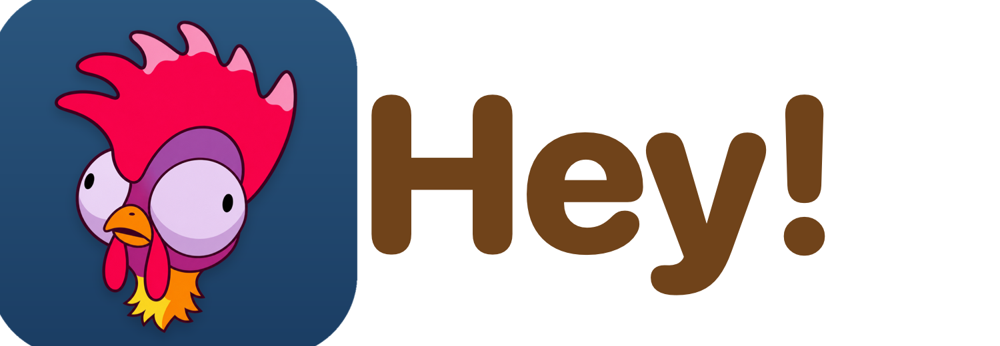</p>

<h3 align="center">เพื่อนตัวน้อยบนเดสก์ท็อป Mac ของคุณ</h3>

<p align="center">
  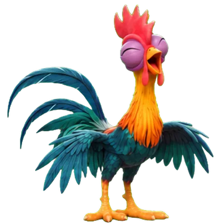
  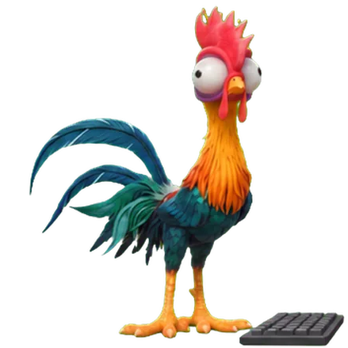
  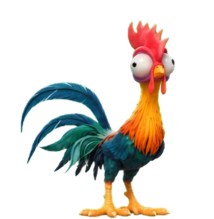
</p>

<p align="center">
  <a href="https://github.com/giganto-th/hey/releases/latest"></a>
  <a href="https://giganto-th.github.io/hey/"></a>
  <a href="https://www.youtube.com/watch?v=JBi-y-_I9jk"></a>
</p>

<p align="center"><a href="README.en.md">English</a> · ภาษาไทย</p>

<p align="center">
  
  
  
  
</p>

---

**Hey!** คือสัตว์เลี้ยง 2D บนหน้าจอ macOS ตัวละครคือ **Hei Hei** ไก่ตัวน้อยที่เดินเล่นอยู่บนเดสก์ท็อป คอยสังเกตว่าคุณกำลังทำอะไรอยู่ พิมพ์นานเกินไปก็ชวนพักสายตา จบรอบโฟกัสก็ดีใจด้วย และมีเครื่องมือเล็ก ๆ ช่วยงานจริง ทุกอย่างทำงานบนเครื่องของคุณ ไม่ต้องสมัครสมาชิก

> ต้องใช้ **macOS 26 (Tahoe)** ขึ้นไป เพราะหน้าตาใช้ Liquid Glass

## ฟีเจอร์เด่น

| | |
|---|---|
| **รู้ใจ ไม่รบกวน** | กระดิกตามจังหวะพิมพ์ ชวนพักสายตา ง่วงเมื่อไม่ใช้เครื่อง หอบเมื่อเครื่องร้อน ตอบสนองแบต ปลั๊กไฟ และการกลับมาใช้เครื่อง |
| **Hey Hub** | ศูนย์กลางแบบ Liquid Glass: สถานะ ภารกิจ ร้านค้า ความสำเร็จ มินิเกม และปรับความโปร่งใสของหน้าต่างได้ |
| **โฟกัส Pomodoro** | 25 นาทีโฟกัส 5 นาทีพัก ได้เหรียญและ XP ไปเลี้ยงสัตว์เลี้ยง |
| **เครื่องมือช่วยงาน** | ประวัติคลิปบอร์ด · อ่านข้อความจากหน้าจอ (ไทย/อังกฤษ) · แคปภาพและอัดจอ · โน้ตแปะ · ตั้งเตือนด้วยภาษาไทย · เตือนนัดจากปฏิทิน |
| **ถาดไฟล์และเพลง** | ลากไฟล์ ข้อความ หรือลิงก์เข้าหาสัตว์เลี้ยงเพื่อเก็บหรือพักไว้ เล่นเพลง YouTube และไฟล์เสียง แล้ว Hei Hei โยกตามเพลง |
| **เครดิต AI** | ดูโควตาแพ็กเกจของ Claude, Codex (ChatGPT) และ Antigravity หลายบัญชีพร้อมกัน พร้อมโลโก้จริงของแต่ละเจ้า ใน Hub › เครดิต AI สัตว์เลี้ยงเตือนเมื่อใช้ไป 80% และ 95% ปุ่ม เพิ่มบัญชี AI บอกวิธีเพิ่มบัญชีที่สอง |
| **สองภาษา** | ไทยและ English เลือกที่ Hub › ตั้งค่า › ภาษา (ตามระบบ / ไทย / English) แล้วเปิดแอปใหม่ |
| **เลือกตัวละคร** | Hei Hei ไก่ตัวผู้ · Shams ลูกเจี๊ยบขนฟู · Shi Shi ลูกเจี๊ยบผมบ็อบ (เปลี่ยนได้ที่ Hub › สัตว์เลี้ยง) |
| **เลี้ยงให้โต** | วางอาหารไว้ตรงไหนของจอก็ได้ แล้วมันเดินไปกินเอง · เป่าฟองสบู่ให้มันวิ่งไล่จิ๊ก · ทำภารกิจ แล้วดูมันโตจากไข่ ลูกไก่ เด็ก วัยรุ่น จนเป็นไก่ตัวเต็มวัย |

## หน้าตา

<p align="center">
  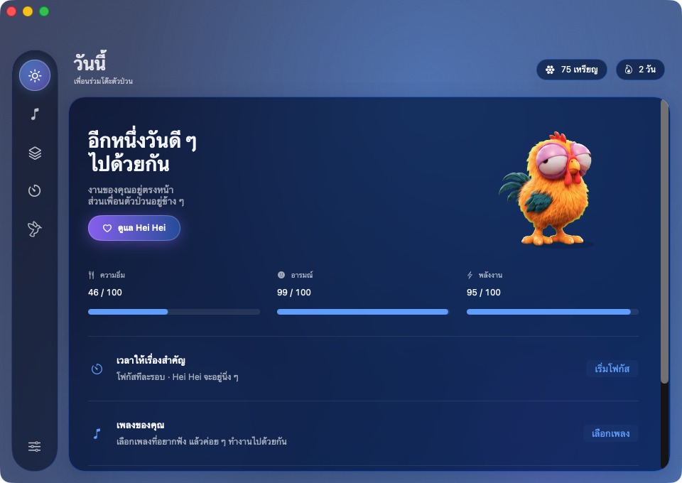
  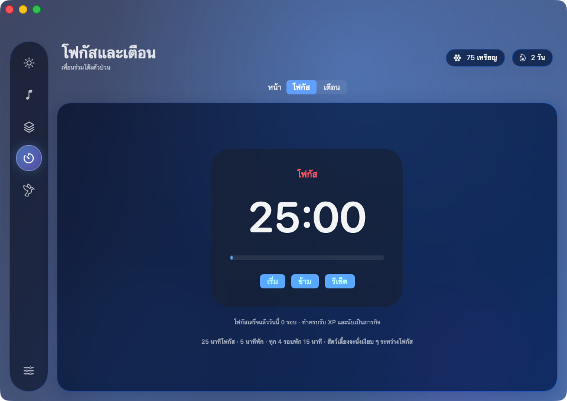
</p>
<p align="center">
  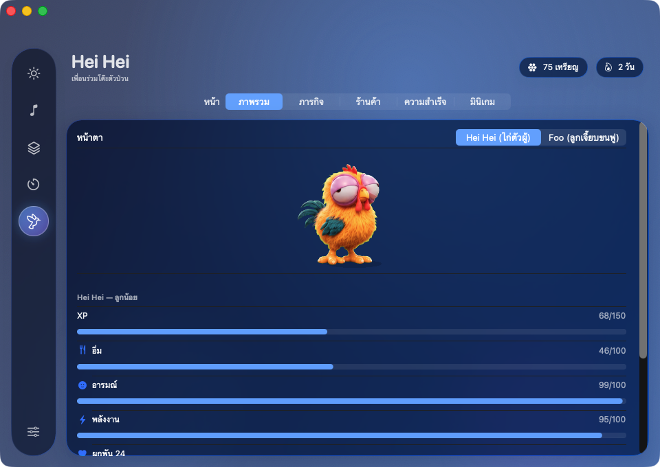
  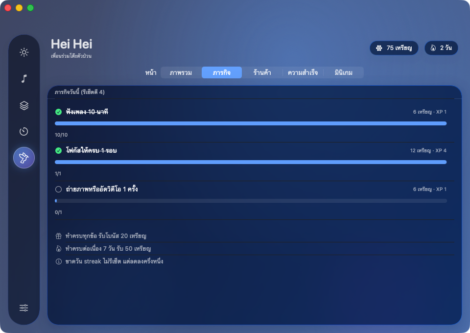
</p>

## เติบโตไปด้วยกัน

<p align="center">
  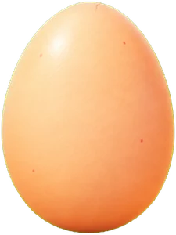
  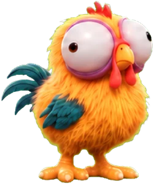
  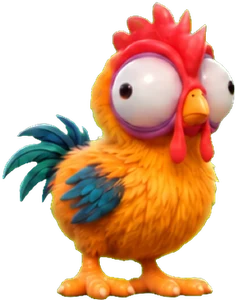
  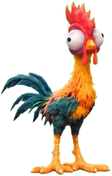
  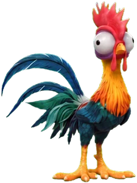
</p>

## ติดตั้ง

**วิธีเร็วที่สุด (ไม่ขึ้นคำเตือน):** เปิด Terminal แล้วรันคำสั่งเดียว

```bash
curl -fsSL https://raw.githubusercontent.com/giganto-th/hey/main/scripts/install.sh | bash
```

สคริปต์โหลดเวอร์ชันล่าสุดด้วย curl (ไฟล์ที่โหลดด้วย curl ไม่ถูกติดธงกักกัน macOS จึงไม่ถาม) ลงใน Applications แล้วเปิดให้เลย

**หรือโหลดเอง:**

1. โหลด `Hey-1.2.0.dmg` จากหน้า [Releases](https://github.com/giganto-th/hey/releases/latest)
2. ลาก **Hey** ไปวางบน **Applications**
3. เปิดแอป

แอปเซ็นด้วย Developer ID และผ่าน Apple notarization แล้ว ดับเบิลคลิกเปิดได้เลย ไม่มีคำเตือน (ถ้าใช้เวอร์ชันเก่า 1.1.0 ลงไป ให้โหลดเวอร์ชันนี้ใหม่)

ปล่อยเวอร์ชันที่เซ็นและผ่าน notarize (ต้องมี Apple Developer ID): ดูขั้นตอนในหัวไฟล์ `scripts/release-signed.sh`

บิลด์เอง: `bash scripts/make-app.sh` (ได้ `build/Hey.app`) และ `bash scripts/make-dmg.sh` (ได้ไฟล์ DMG) แอปที่บิลด์เองไม่ถูกกัก

## คู่มือการใช้งาน


### วิธีเล่น

คลิกไข่/ลูบเพื่ออุ่น → ฟักเป็นสัตว์เลี้ยง → คลิกขวาที่ตัวสัตว์ (หรือไอคอน 🐾 บนเมนูบาร์) เพื่อดูสถานะและให้อาหาร

### คีย์ลัด (ทั้งระบบ)

| คีย์ | ทำอะไร |
|---|---|
| ⌃⌥R | ตั้งเตือนด่วน (พิมพ์ เช่น `ประชุม อีก 20 นาที`, `พรุ่งนี้ 9 โมง ส่งงาน`, `กินยา 18:30`) |
| ⌃⌥N | โน้ตแปะใหม่ลอยบนจอ |
| ⌃⌥P | เริ่ม/หยุด Pomodoro |
| ⌃⌥H | เปิด Hub |
| ⌃⌥S | แคปภาพเลือกพื้นที่ (Esc ยกเลิก) |
| ⌃⌥V | เริ่ม/หยุดอัดหน้าจอ |
| ⌃⌥M | เล่น/หยุดเพลง |
| ⌃⌥] / ⌃⌥[ | เพลงถัดไป / ก่อนหน้า |

### ให้อาหาร และฟองสบู่
- **ให้อาหาร:** เมนูวงกลม › อาหาร › เลือกอาหาร แล้วคลิกตรงไหนของหน้าจอก็ได้ อาหารจะร่วงลงพื้น Hei Hei เดินไปกินเอง (Esc หรือคลิกขวาเพื่อยกเลิก) อาหารที่ยังกินไม่ได้ (อิ่ม ยังไม่ครบเวลา ไม่มีของ) จะแจ้งก่อนวาง
- **ฟองสบู่:** เมนูวงกลม › เพิ่มเติม › ฟองสบู่ (หรือเมนูแถบเมนู "เป่าฟองสบู่", ลิงก์ `hey://bubbles`) ฟองลอยไปมาบนจอ สักพักก็ค่อย ๆ ลงมาถึงพื้น Hei Hei จะจิ๊กได้เฉพาะฟองที่ลงมาอยู่บนพื้นแล้วเท่านั้น

### ไฟล์: 2 ระบบ

**ลากอะไรก็ได้ (ไฟล์ โฟลเดอร์ ข้อความ ลิงก์) เข้าหาสัตว์เลี้ยง** จะมีช่องกระจก 2 ช่องโผล่เหนือหัว ปล่อยลงช่องที่ต้องการ:
- **ฝากเก็บ** (vault) — เก็บถาวร ไฟล์เล็กคัดลอกไว้ ไฟล์ใหญ่/โฟลเดอร์อ้างอิงตำแหน่งเดิม ค้นหา ติดแท็ก ปักหมุด ตั้งหมดอายุ ลากรายการออกไปวางที่ Finder เดสก์ท็อป หรือแอปอื่นได้ (วางเป็นสำเนา ต้นฉบับไม่หาย)
- **พักไว้ลากต่อ** (ถาดพักไฟล์) — ที่พักชั่วคราว ไม่ก็อปปี้ ขึ้นเป็นการ์ดมุมซ้ายล่างของจอ ลากรายการออกไปวางที่ไหนก็ได้ เอาออกเองหลังลากสำเร็จ และล้างเองใน 24 ชม.

ปล่อยลงตัวสัตว์ตรงๆ จะใช้ค่าเริ่มต้น (ปกติ = ฝากเก็บ เปลี่ยนได้ที่ Hub › ฝากไฟล์) เมนู 🐾 มี "ถาดพักไฟล์" ไว้เปิด/ปิดถาด

### เพลง

แท็บ "เพลง" ใน Hub: วางลิงก์ YouTube (วิดีโอเดี่ยว) หรือเพิ่มไฟล์เสียง แล้วดับเบิลคลิกเพื่อเล่น ลากเรียงลำดับได้ ลากลิงก์ YouTube มาวางที่ตัวสัตว์เลี้ยงก็เข้า playlist ปัจจุบัน (ลิงก์อื่นเข้า vault) สัตว์เลี้ยงโยกตัวตามเพลง

### ถ่ายภาพ / อัดวิดีโอ

แท็บ "ถ่าย/อัด" ใน Hub หรือเมนู 🐾 → ถ่าย/อัด: ภาพทั้งจอ (นับถอยหลัง 3 วินาที), เลือกพื้นที่, อัดหน้าจอ, กล้อง ครั้งแรกที่ใช้ macOS จะขอสิทธิ์ Screen Recording / กล้อง / ไมค์ (หลังอนุญาต Screen Recording ต้องเปิดแอปใหม่หนึ่งครั้ง) ไฟล์อยู่ที่ `~/Pictures/Hey` และ `~/Movies/Hey` ลบจากแกลเลอรีคือย้ายไปถังขยะ

### ท่าทางและมุมจอ

แท็บ "ท่าทาง" ใน Hub: ตั้งคำสั่งให้ท่า ปัด 4 ทิศ/หมุน 2 นิ้ว/ดับเบิลคลิก บนตัวสัตว์เลี้ยง (ค่าเริ่มต้น: ปัดซ้าย = เพลงถัดไป, ปัดขวา = ก่อนหน้า, ปัดขึ้น/ลง = เสียงดัง/เบา) pinch ย่อ-ขยายสัตว์เลี้ยง และมุมจอ (ปิดไว้ก่อน) ที่ค้างเมาส์ไว้แล้วสั่งงาน เช่น เรียกสัตว์มาหาเมาส์

### ความสำเร็จ มินิเกม และพฤติกรรมของสัตว์เลี้ยง

- แท็บ "ความสำเร็จ": 21 อย่าง (รวมจิ๊กฟองสบู่) ปลดล็อกแล้วได้เหรียญ · แท็บ "มินิเกม": จับอาหารที่ร่วง 20 วินาที รับเหรียญได้ 3 รอบต่อวัน
- สัตว์เลี้ยงทักตอนดึก (หลัง 23:00), ต้อนรับตอนกลับมาหลังหายไป 30 นาทีขึ้นไป และเตือนพักสายตาเมื่อนั่งต่อเนื่อง 90 นาที
- เมื่อโตถึงวัยรุ่น จะขึ้นไปเดิน/ยืนบนขอบหน้าต่างของแอปอื่นได้ (ปิดได้ในแท็บ "สัตว์เลี้ยง") ปล่อยสัตว์เหนือขอบหน้าต่างก็ลงยืนบนนั้น

### เจอเพลง YouTube แล้วเพิ่มให้

คัดลอกลิงก์ YouTube → มีการ์ดมุมขวาล่างถามว่าจะ "เพิ่มเข้าเพลย์ลิสต์" / "เพิ่มและเล่น" / ไม่เอา (หายเองใน 25 วินาที) เปิด/ปิดได้ในแท็บ "เพลง" ที่นั่นมีอีกตัวเลือกให้ตรวจแท็บหน้าสุดของเบราว์เซอร์ที่เปิดหน้าวิดีโอ YouTube อยู่ (ปิดไว้ก่อน ต้องอนุญาตสิทธิ์ระบบอัตโนมัติ)

### ปฏิกิริยาของสัตว์เลี้ยง

พิมพ์คีย์บอร์ด → สัตว์กระดิกตามจังหวะและไม่เดินหนี (พิมพ์เร็วนานๆ ก็ชม) · แบตเหลือ ≤ 20% สั่นและซีด, ≤ 10% สั่นแรงกะพริบแดง · เสียบปลั๊กดีใจ/แบตเต็มบอก · เครื่องร้อนหอบ · ไม่ใช้เครื่อง 3 นาทีงีบ ใช้ต่อก็ตื่น · เครื่องตื่นจากหลับหาว · เมาส์เข้าใกล้ก็หันมอง ปิดแต่ละอย่างได้ใน Hub › สัตว์เลี้ยง

### ชื่อเพลงบนแถบเมนู

ขณะมีเพลง จะมีไอคอน ♪ กับชื่อเพลง (— ศิลปิน) บนแถบเมนู ถ้ายาวจะวิ่งเป็นวงต่อเนื่อง คลิกเพื่อหยุด/เล่นต่อ/ข้ามเพลง หรือซ่อน (ปิดถาวรได้ใน Hub › เพลง)

### เมนูของสัตว์เลี้ยง
คลิกขวาที่ตัวสัตว์ (หรือ ⌥ ค้างแล้วคลิกไอคอนบนแถบเมนู) → ปุ่มกระจกกางเป็นวงโค้งชิดตัว หันไปทางที่มีที่ว่างบนจอ พร้อมการ์ดสถานะด้านบน หน้าแรกมีปุ่มที่ปักไว้ (ค่าเริ่มต้น: เล่นเพลง · ฝากไฟล์ · โฟกัส · ให้อาหาร · Hub) กับโฟลเดอร์ 3 อัน:
- **จับภาพ:** แคปจอ · อัดจอ · อ่านข้อความ
- **จดและเตือน:** โน้ต · ตั้งเตือน · คลิปบอร์ด (และ โฟกัส ถ้าไม่ได้ปักไว้)
- **อื่น ๆ:** ถาดไฟล์ · ฟองสบู่ (และคำสั่งที่เอาลงจากวงแรก)

กดปุ่มอาหารเพื่อเลือกอาหารแล้วคลิกวางบนจอ ย้ายคำสั่งขึ้นวงแรกหรือลงโฟลเดอร์ได้ที่ Hub › ตั้งค่า คลิกไอคอนบนแถบเมนู (ซ้ายหรือขวา) จะได้เมนูสรุป: การ์ดสัตว์เลี้ยง การ์ดเครดิต AI ทุกบัญชี และคำสั่งจัดเป็นหมวด สัตว์เลี้ยง / เครื่องมือ / เพลงและโฟกัส พร้อมคีย์ลัด การซ่อน/แสดงสัตว์เลี้ยงอยู่ในเมนูแถบเมนู

---

## สำหรับนักพัฒนา

### UX และตัวละครรุ่นใหม่

Hei Hei ใช้ตัววาด 2D แบบแยกชิ้นส่วน: จิกคีย์บอร์ดจิ๋วขณะพิมพ์ เต้นขณะเพลงเล่น และหยุดกิจกรรมให้เมื่ออุ้ม เปิดเมนู ลากไฟล์ หรือโฟกัส หลังหยุดพิมพ์ 2.5 วินาทีจะกลับไปกิจกรรมเดิม การเต้นใช้จังหวะอัตโนมัติ ยังไม่ได้วิเคราะห์ beat ของเสียง

Hub ใหม่มี 6 หมวด พร้อมหน้าวันนี้และตัวอย่างท่าที่ **การตั้งค่า › การเคลื่อนไหวของ Hei Hei** ปรับตาม Reduce Motion ของระบบ หรือเลือกเต็ม/นุ่มนวล/ลดการเคลื่อนไหวเองได้ เซฟ Tok รุ่นเก่าย้ายกลับเป็น Hei Hei โดยรักษาชื่อที่ตั้งเองและความคืบหน้า

ดู [สเปก UX/แอนิเมชัน](docs/redesign/UX-MOTION-SPEC.md), [สถานะ implementation](docs/redesign/IMPLEMENTATION.md) และ [ต้นแบบสำหรับเปิดในเบราว์เซอร์](docs/redesign/preview.html)

### รัน

แบบ .app (แนะนำถ้าจะใช้ถ่าย/อัด เพราะสิทธิ์ของ macOS ผูกกับตัวแอป):

```bash
scripts/make-app.sh && open build/Hey.app
```
ถ้าไม่ตั้ง `HEY_SIGN_IDENTITY="Apple Development: …"` แอปจะเซ็นแบบ ad-hoc และสิทธิ์ต้องกดอนุญาตใหม่หลัง build ทุกครั้ง

แบบพัฒนา:

```bash
swift build && .build/debug/Hey
```

รันจากโฟลเดอร์โปรเจกต์เพื่อให้พบภาพไข่/อาหารใน `Resources/` ส่วนตัวละคร Hei Hei แบบขยับวาดด้วย rig ในโค้ด

- `HEY_DEV=1` เพิ่มเมนู dev (อุ่นไข่ +50, +100 XP, +100 เหรียญ, เตือนใน 5 วินาที)
- `HEY_DEV_DROP=/path/a:/path/b` และ `HEY_DEV_DROP_TEXT=...` (ต้องมี `HEY_DEV=1`) ฝากไฟล์/ข้อความเข้า vault ตอนเปิดแอป ไว้ทดสอบโดยไม่ต้องลาก
- `HEY_DEV_PLAY=<videoId>` เล่น YouTube แบบปิดเสียงเพื่อทดสอบ (`toggle` = เล่นเพลงแรกของ playlist) และ `HEY_DEV_LOG_MUSIC=1` ดู log ของตัวเล่น
- `HEY_DEV_TIER=full|balanced|saver|dormant`, `HEY_DEV_CALM=1`, `HEY_DEV_FPS=<n>` ใช้ตอนวัดพลังงาน
- `HEY_DEV_FAKE="battery=15,ac=0,thermal=3,idle=200"` จำลองแบต/ความร้อน/ไม่ใช้เครื่อง เพื่อดูท่าทางต่างๆ และ `HEY_DEV_LOG=1` พิมพ์ mood/reaction ที่เกิดขึ้น
- `HEY_DATA_DIR=<path>` เก็บข้อมูลที่อื่น (ใช้ตอนทดสอบ)
- `HEY_SPRITES_DIR=<path>` ชี้โฟลเดอร์ `Sprites` เอง (ข้างในมีโฟลเดอร์ต่อสายพันธุ์ เช่น `heihei/`)

### ทดสอบ

```bash
swift test
```

### โลโก้และไอคอน

หัว Hei Hei ภาพหลักวาดโดย Codex อยู่ใน `Resources/Logo/` (ไอคอนแอป `heihei_icon.png`, หัวเดี่ยว `heihei_head.png`) รัน `scripts/make-icon.sh` เพื่อสร้าง `Resources/AppIcon.icns` กับ `docs/logo.png` ใหม่ ถ้าไม่มีไฟล์ภาพจะใช้ที่วาดด้วยโค้ดใน `Sources/Hey/LogoArt.swift` แทน ไอคอนบนแถบเมนูเป็นเงาหัวที่วาดด้วยโค้ด (ย่อเล็กแล้วอ่านง่ายกว่า) ปรับสีตามโหมดมืด/สว่างเอง

แผนและสเปกทั้งหมด: [docs/DESIGN.md](docs/DESIGN.md) · [docs/ROADMAP.md](docs/ROADMAP.md) · [pipeline ภาพตัวละคร](docs/SPRITE_PIPELINE.md)

## โครงสร้างโปรเจกต์

- `Sources/HeyDomain` ตรรกะล้วน (สัตว์เลี้ยง พฤติกรรม เควสต์ ฯลฯ) ทดสอบด้วย Swift Testing
- `Sources/Hey` แอป AppKit, SpriteKit และ SwiftUI
- `Resources` ภาพตัวละคร ไอคอน และโลโก้
- `docs` เอกสาร และหน้าเว็บ [giganto-th.github.io/hey](https://giganto-th.github.io/hey/)
